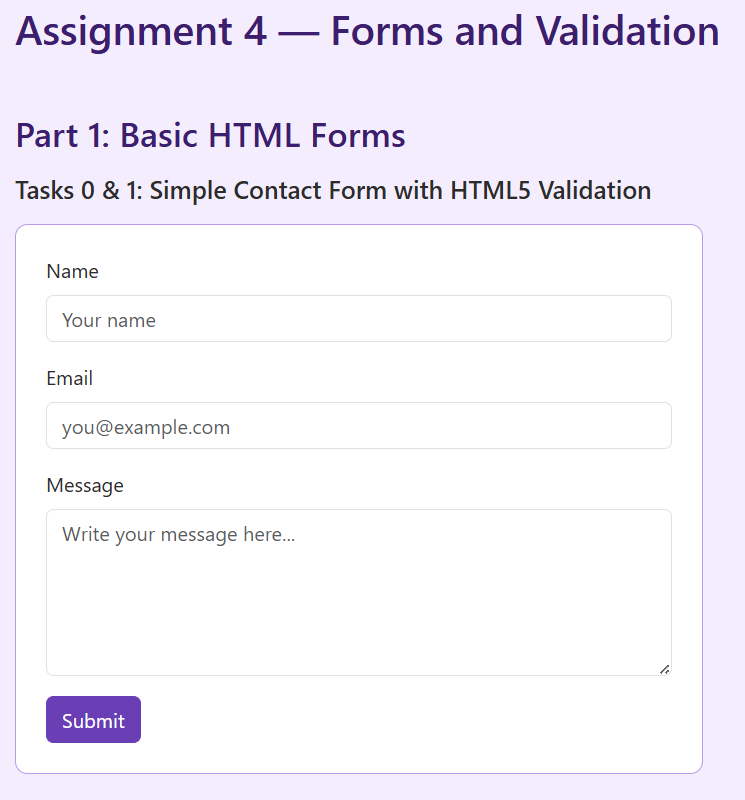
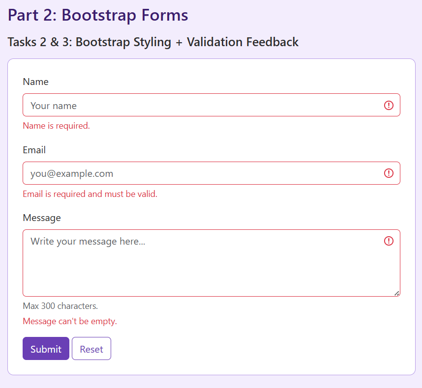
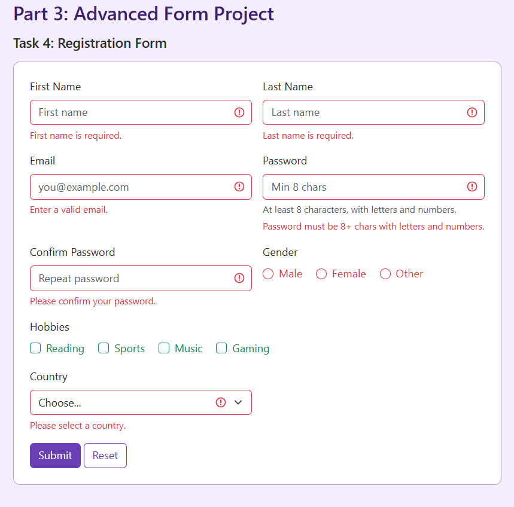

# Assignment 4 — Forms and Validation

**Name:** Moldir Jarmukhambetova  
**Group:** SE-2540

A single-page project covering all five tasks — a basic HTML contact form, HTML5 validation, Bootstrap form styling, Bootstrap validation feedback, and a full registration form.

---

## Part 1 — Basic HTML Forms

### Task 0: Simple Contact Form

Basic contact form with Name, Email, Message and a Submit button. Every input has a '<label>' with a matching 'for'/'id' so clicking the label focuses the field.

### Task 1: HTML5 Validation

Added 'required', 'type="email"', and 'maxlength' to the fields. I tested it by leaving fields empty (browser blocks submit and shows its own tooltip) and by typing a broken email like 'abc' got the "Please include an '@'" message.

---

## Part 2 — Bootstrap Forms

### Task 2: Bootstrap Form Styling

Rebuilt the same form using Bootstrap. Used the grid ('row', 'col-md-6', 'col-12') so it goes side-by-side on wider screens and stacks on mobile. Added placeholders and a helper text under the message field.

### Task 3: Bootstrap Validation Styles

Used Bootstrap's 'was-validated' class on the form together with 'invalid-feedback' and 'valid-feedback' blocks under each input. Tested both states — left fields empty to see the red messages, filled them in to see the green "Looks good!" ones.

---

## Part 3 — Advanced Form Project

### Task 4: Registration Form

Full registration form with all the required fields: first/last name, email, password + confirm, gender radios, hobby checkboxes, country dropdown, and submit/reset buttons.

Used the Bootstrap grid to lay it out — 'col-md-6' for the fields that fit side-by-side, 'col-12' for the hobbies row. It stacks into one column on small screens automatically.

For validation I used:

- 'required' on most fields
- 'type="email"' on the email field
- 'minlength="8"' on the password
- a 'pattern' on the password so it needs at least one letter and one number
- 'required' on the first gender radio

---

## Summary

I built one HTML page with all the tasks in their own sections and styled it with a purple theme. Tasks 0 and 1 are plain HTML and CSS, tasks 2 and 3 add Bootstrap's grid and validation classes, and task 4 is the full registration form. Most of the work was in the HTML — getting the validation attributes and Bootstrap's feedback classes to line up took longer than the CSS did.